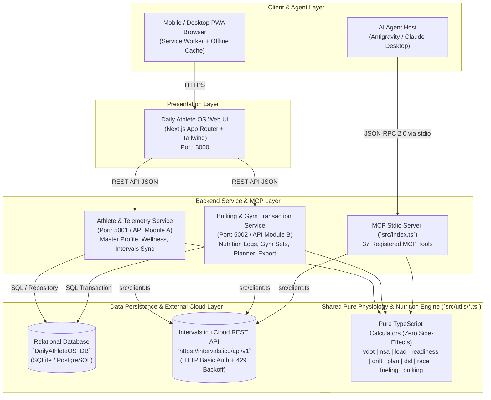
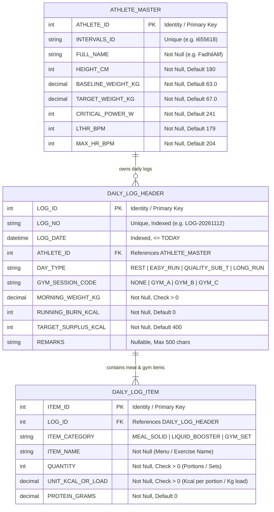
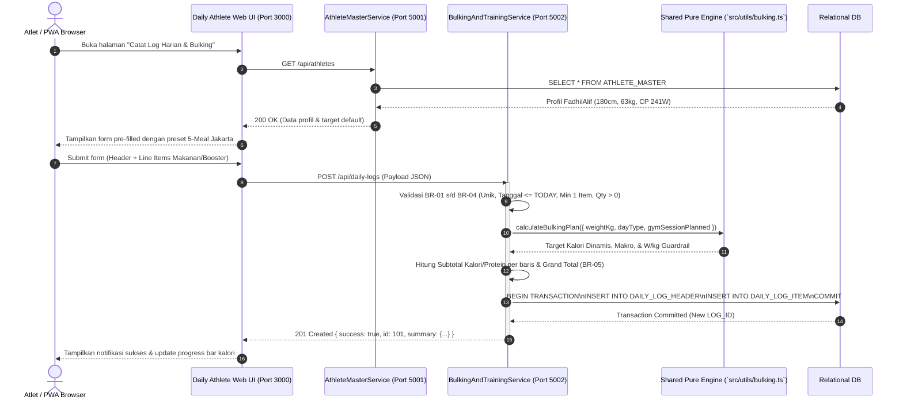
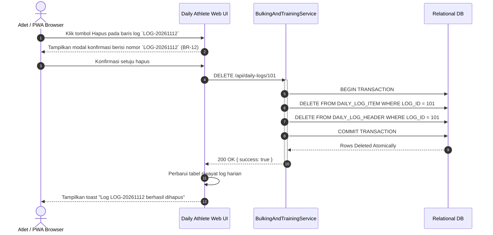
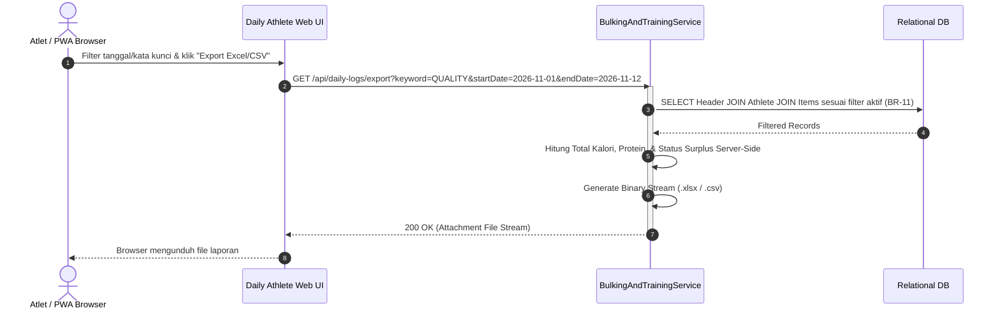

# SYSTEM ARCHITECTURE DOCUMENT (ARCHITECTURE.md)
<!-- 
================================================================================
🤖 INSTRUKSI UNTUK AI AGENT (PANDUAN OPERASIONAL):
1. MODE PEMBUATAN DOKUMEN (GENERATION):
   - Dokumen ini merupakan cetak biru arsitektur resmi untuk pengembangan Daily Athlete OS (PWA + MCP Server).
   - Patuhi pemisahan tanggung jawab (Separation of Concerns) antara Presentation Layer (PWA), Backend Service Layer, Shared Pure Engine (`src/utils/*`), dan Persistence Layer.

2. MODE PENILAIAN / ASESMEN (ASSESSMENT):
   - Gunakan Bagian 10 (Rubrik Asesmen Arsitektur AI) untuk mengaudit kepatuhan arsitektur selama implementasi.
================================================================================
-->

## Daily Athlete OS (`intervals-icu-mcp`) — Arsitektur Sistem
### Modular Monolith & Shared Pure Domain Engine (Dual-Interface: Progressive Web App + MCP Stdio Server)

| Metadata Dokumen | Nilai |
|------------------|-------|
| **Versi** | 1.0 |
| **Tanggal Terbit** | 2026-11-12 |
| **Pola Arsitektur** | Modular Monolith + Clean Layered Architecture (Dual Interface: REST API & MCP Stdio) |
| **Arsitek / Penulis** | FadhilAlif (`i655618`) & AI Solution Architect |
| **Status Dokumen** | Approved / Active Implementation |

---

## 1. Gambaran Umum Arsitektur (High-Level Architecture)

### 1.1 Deskripsi Gaya Arsitektur
**Daily Athlete OS** mengadopsi pola **Modular Monolith dengan Shared Pure Domain Engine (`src/utils/*.ts`)** yang melayani dua antarmuka konsumen secara simultan (**Zero-Rewrite Architecture**):
1. **AI Agent Interface (`stdio` MCP Server — `src/index.ts`)**: Mengekspos **37 MCP Tools** ke AI Assistant (Antigravity, Claude Desktop, Cursor) untuk analisis taktis dan eksekusi *slash commands* (`/bulk-plan`, `/plan-week`, `/readiness-check`, dll.).
2. **Progressive Web App Interface (Web PWA & REST Backend)**: Menyajikan dashboard *mobile-first* yang dapat di-install di smartphone (`manifest.json` + *Service Worker*) dan berkomunikasi melalui HTTP REST JSON ke layanan backend tanpa akses database langsung maupun duplikasi rumus fisiologis di browser.

Penyimpanan data bersifat **Hybrid**:
- **Cloud Telemetry Store (`Intervals.icu REST API`)**: Menyimpan aktivitas lari, stream detak jantung/watt, kurva daya, wellness harian (berat badan, RHR, HRV, tidur), dan jadwal kalender.
- **Transactional Relational Database (`PostgreSQL / SQLite`)**: Menyimpan master profil atlet, header & detail item log nutrisi harian (*clean bulking* + *liquid boosters*), serta header & detail set progres beban gym (`GYM_A`, `GYM_B`, `GYM_C`).

### 1.2 Diagram Arsitektur Tingkat Tinggi (Mermaid Container Diagram)



---

## 2. Katalog Komponen & Tanggung Jawab Layanan

### 2.1 `AthleteMasterService` (Master Data & Telemetry Sync Service)
| Aspek | Spesifikasi & Keterangan |
|-------|--------------------------|
| **Port Default** | HTTP: `5001` (atau Route Namespace `/api/master/*`) |
| **Tech Stack** | Node.js `>=18.0.0`, TypeScript `^5.7.2`, Zod `^4.4.3`, Native `fetch` (`src/client.ts`) |
| **Domain & Tanggung Jawab** | Mengelola data referensi profil atlet (`ATHLETE_MASTER`), katalog menu makanan/latihan (`CATALOG_ITEM`), sinkronisasi wellness/aktivitas dari Intervals.icu, dan kalkulasi kesiapan pagi (*Readiness*). |
| **Tabel Database yang Dikelola** | `ATHLETE_MASTER`, `CATALOG_ITEM` |
| **Daftar Endpoint Utama** | `GET /api/athletes`, `GET /api/athletes/{id}`, `GET /api/catalog-items`, `GET /api/telemetry/readiness` |
| **Akses Database Lintas Domain** | **TIDAK DIIZINKAN** — Hanya membaca dan menulis tabel master milik domain sendiri. |
| **Konsumen Layanan** | `Daily Athlete OS Web UI`, `Bulking & Gym Transaction Service` |

### 2.2 `BulkingAndTrainingService` (Transactional & Planning Service)
| Aspek | Spesifikasi & Keterangan |
|-------|--------------------------|
| **Port Default** | HTTP: `5002` (atau Route Namespace `/api/transactions/*`) |
| **Tech Stack** | Node.js `>=18.0.0`, TypeScript `^5.7.2`, Shared Pure Engine (`src/utils/*.ts`), SQL Transaction Runner, Excel/CSV Generator |
| **Domain & Tanggung Jawab** | Mengelola siklus hidup transaksi log harian (Nutrisi Bulking + Sesi Gym), kalkulasi server-side BMR/TDEE/Makro (`calculateBulkingPlan`), publikasi jadwal mingguan ke Intervals.icu, serta ekspor laporan (`.xlsx` / `.csv`). |
| **Tabel Database yang Dikelola** | `DAILY_LOG_HEADER`, `DAILY_LOG_ITEM`, Read-only JOIN ke `ATHLETE_MASTER` |
| **Daftar Endpoint Utama** | `GET /api/daily-logs`, `GET /api/daily-logs/{id}`, `POST /api/daily-logs`, `PUT /api/daily-logs/{id}`, `DELETE /api/daily-logs/{id}`, `GET /api/daily-logs/export`, `POST /api/planner/publish` |
| **Konsumen Layanan** | `Daily Athlete OS Web UI` |

### 2.3 `DailyAthleteWebUI` (PWA Presentation Layer)
| Aspek | Spesifikasi & Keterangan |
|-------|--------------------------|
| **Port Default** | HTTP: `3000` (atau `5000`) |
| **Tech Stack** | Next.js (App Router), React 19, Tailwind CSS, PWA Service Worker (`manifest.json`) |
| **Peran Utama** | Menyajikan 5 modul layar utama (`Today Cockpit`, `NSA Lab`, `Bulking & Gym Studio`, `Weekly Planner`, `Race Command Center`), timer isometrik *McGill Big 3*, serta *offline pocket card*. |
| **Batasan Arsitektural** | **STRICT: NO DATABASE ACCESS & NO CLIENT-SIDE BUSINESS MATH**. Dilarang mengimpor driver database atau menghitung nominal kalori/makro/VDOT/ACWR di sisi browser. |
| **Komunikasi Keluar** | Menggunakan HTTP REST Client terpusat menuju `AthleteMasterService` dan `BulkingAndTrainingService`. |

---

## 3. Skema & Model Data (Database Schema)

### 3.1 Entity Relationship Diagram (ERD)



### 3.2 Spesifikasi Tabel & Constraint

#### Tabel 1: `ATHLETE_MASTER` (Tabel Master Profil Atlet)
| Nama Kolom | Tipe Data | Nullable | Key / Constraint | Keterangan Bisnis |
|------------|-----------|----------|------------------|-------------------|
| `ATHLETE_ID` | `INT` | No | PK, IDENTITY(1,1) | Identifier internal atlet |
| `INTERVALS_ID` | `VARCHAR(20)` | No | UNIQUE INDEX | ID akun Intervals.icu (contoh: `i655618`) |
| `FULL_NAME` | `VARCHAR(100)` | No | - | Nama lengkap atlet (`FadhilAlif`) |
| `HEIGHT_CM` | `INT` | No | CHECK > 0 | Tinggi badan dalam cm (`180`) |
| `BASELINE_WEIGHT_KG` | `DECIMAL(5,2)` | No | CHECK > 0 | Berat badan awal (`63.00`) |
| `TARGET_WEIGHT_KG` | `DECIMAL(5,2)` | No | CHECK > 0 | Target berat badan *clean bulking* (`67.00`) |
| `CRITICAL_POWER_W` | `INT` | No | CHECK > 0 | Critical Power lari aktif (`241`) |
| `LTHR_BPM` | `INT` | No | CHECK > 0 | Lactate Threshold Heart Rate (`179`) |
| `MAX_HR_BPM` | `INT` | No | CHECK > 0 | Maximum Heart Rate terukur (`204`) |

#### Tabel 2: `DAILY_LOG_HEADER` (Tabel Transaksi Induk Log Nutrisi & Latihan Harian)
| Nama Kolom | Tipe Data | Nullable | Key / Constraint | Keterangan Bisnis |
|------------|-----------|----------|------------------|-------------------|
| `LOG_ID` | `INT` | No | PK, IDENTITY(1,1) | Identifier unik transaksi log harian |
| `LOG_NO` | `VARCHAR(20)` | No | UNIQUE INDEX | Nomor dokumen unik (contoh: `LOG-20261112`) |
| `LOG_DATE` | `DATETIME` | No | INDEX | Tanggal log harian (`<= TODAY`) |
| `ATHLETE_ID` | `INT` | No | FK → `ATHLETE_MASTER` | Relasi ke profil atlet |
| `DAY_TYPE` | `VARCHAR(20)` | No | - | `REST`, `EASY_RUN`, `QUALITY_SUB_T`, `LONG_RUN` |
| `GYM_SESSION_CODE` | `VARCHAR(10)` | No | - | `NONE`, `GYM_A`, `GYM_B`, `GYM_C` |
| `MORNING_WEIGHT_KG` | `DECIMAL(5,2)` | No | CHECK > 0 | Berat badan timbangan pagi hari |
| `RUNNING_BURN_KCAL` | `INT` | No | CHECK >= 0 | Kalori lari aktual dari Intervals.icu |
| `TARGET_SURPLUS_KCAL`| `INT` | No | - | Target surplus kalori bersih (default `400`) |
| `REMARKS` | `VARCHAR(500)` | Yes | - | Catatan RPE, kualitas tidur, atau sensasi otot |

#### Tabel 3: `DAILY_LOG_ITEM` (Tabel Detail Rincian Makanan / Set Latihan)
| Nama Kolom | Tipe Data | Nullable | Key / Constraint | Keterangan Bisnis |
|------------|-----------|----------|------------------|-------------------|
| `ITEM_ID` | `INT` | No | PK, IDENTITY(1,1) | Identifier unik baris item |
| `LOG_ID` | `INT` | No | FK → `DAILY_LOG_HEADER` | Relasi ke induk log harian |
| `ITEM_CATEGORY` | `VARCHAR(30)` | No | - | `MEAL_SOLID`, `LIQUID_BOOSTER`, atau `GYM_SET` |
| `ITEM_NAME` | `VARCHAR(100)` | No | - | Nama makanan/minuman atau gerakan gym |
| `QUANTITY` | `INT` | No | CHECK > 0 | Jumlah porsi makan atau jumlah set latihan |
| `UNIT_KCAL_OR_LOAD` | `DECIMAL(18,2)` | No | CHECK > 0 | Kalori per porsi (`kkal`) atau beban angkatan (`kg`) |
| `PROTEIN_GRAMS` | `DECIMAL(8,2)` | No | CHECK >= 0 | Gram protein per porsi satuan |

> ℹ️ **Catatan Field Komputasi Runtime**:
> - `Item Subtotal Kalori = QUANTITY * UNIT_KCAL_OR_LOAD`
> - `Item Subtotal Protein = QUANTITY * PROTEIN_GRAMS`
> - `Grand Total Kalori Masuk = SUM(QUANTITY * UNIT_KCAL_OR_LOAD)`
> - `Target Kalori Dinamis` dihitung saat runtime menggunakan `calculateBulkingPlan()` di `src/utils/bulking.ts`.

---

## 4. Struktur Internal Service & Desain Layer (Layered Architecture)

### 4.1 Pola Lapisan (Layered Architecture Pattern)

```
   HTTP Request (Web PWA)          JSON-RPC 2.0 (AI Agent via stdio)
             │                                    │
             ▼                                    ▼
┌────────────────────────┐          ┌──────────────────────────┐
│    Controller Layer    │          │  MCP Tool Handler Layer  │
│  (Validation & HTTP)   │          │   (`src/tools/*.ts`)     │
└───────────┬────────────┘          └────────────┬─────────────┘
            └─────────────────┬──────────────────┘
                              ▼
             ┌────────────────────────────────┐
             │  Service & Pure Engine Layer   │
             │  - Business Rules (BR-01..12)  │
             │  - `src/utils/*.ts` Calculators│
             └────────┬──────────────┬────────┘
                      │              │
                      ▼              ▼
       ┌───────────────────┐    ┌────────────────────────┐
       │ Repository Layer  │    │ Intervals HTTP Client  │
       │ (SQL Transactions)│    │   (`src/client.ts`)    │
       └─────────┬─────────┘    └───────────┬────────────┘
                 ▼                          ▼
       ┌───────────────────┐    ┌────────────────────────┐
       │ Relational DB     │    │ Intervals.icu Cloud API│
       └───────────────────┘    └────────────────────────┘
```

### 4.2 Standar Struktur Folder Proyek (Monorepo)

```
intervals-icu-mcp/
├── src/                              ← Core MCP Server & Shared Pure Engine
│   ├── tools/                        ← 10 MCP Tool Domain Modules (37 Tools)
│   │   ├── activities.ts
│   │   ├── athlete.ts
│   │   ├── calculator.ts
│   │   ├── customItems.ts
│   │   ├── events.ts
│   │   ├── gear.ts
│   │   ├── intelligence.ts           ← Termasuk `calculate_bulking_plan`
│   │   ├── load.ts
│   │   ├── powerCurves.ts
│   │   └── wellness.ts
│   ├── utils/                        ← 10 Pure Physiology & Nutrition Calculators
│   │   ├── bulking.ts                ← BMR, TDEE, Macros, W/kg, Gym Presets A/B/C
│   │   ├── cache.ts                  ← In-Memory TTL Cache
│   │   ├── date.ts
│   │   ├── drift.ts                  ← Aerobic Decoupling EF H1 vs H2
│   │   ├── dsl.ts                    ← Validator Teks DSL Intervals.icu
│   │   ├── fueling.ts                ← Strategi Gel 30g Carb & Hidrasi Tropis
│   │   ├── load.ts                   ← ACWR, Ramp Rate, Weekly Budget 75/25
│   │   ├── nsa.ts                    ← Matriks Interval Waktu NSA
│   │   ├── plan.ts                   ← Generator Rencana Mingguan Deterministik
│   │   ├── race.ts                   ← Prediksi Race & A-Taper 10-14 Hari
│   │   ├── readiness.ts              ← Skor Kesiapan 0-100% (Green/Yellow/Red)
│   │   ├── retry.ts                  ← Exponential Backoff + Jitter HTTP 429
│   │   └── vdot.ts                   ← Rumus Jack Daniels VDOT & Zona Pace
│   ├── client.ts                     ← HTTP Client Intervals.icu
│   ├── config.ts                     ← Pembaca Environment Variables
│   ├── index.ts                      ← Entry Point MCP Stdio Server
│   └── types.ts
│
├── web/                              ← Aplikasi Web PWA & Backend API (Daily Athlete OS)
│   ├── src/
│   │   ├── controllers/              ← REST Route Controllers
│   │   ├── services/                 ← Business Logic Services (memanggil `src/utils/*`)
│   │   ├── repositories/             ← Database Access Layer (Transaksi Atomik)
│   │   ├── models/                   ← Entities, RequestDTO, ResponseDTO
│   │   └── components/               ← UI Components (Cockpit, Bulking Studio, Planner)
│   └── public/
│       └── manifest.json             ← Konfigurasi Installable PWA
│
├── Database/                         ← Skrip Basis Data Relasional
│   ├── schema.sql                    ← DDL Tabel, Constraints, Indexes & Seed Data
│   └── sp_get_daily_logs.sql         ← Stored Procedure / Query Teroptimasi
│
├── .agents/                          ← Aturan & 16 Skills AI Running/Bulking Coach
│   ├── rules/
│   └── skills/
│
└── docs/                             ← Dokumentasi Rekayasa Perangkat Lunak
    ├── PRD.md
    ├── ARCHITECTURE.md
    └── PROGRESS.md
    └── WORKFLOWS-GUIDE.md
```

---

## 5. Alur Komunikasi Antar Layanan (Sequence Flows)

### 5.1 Alur Pencatatan Log Nutrisi & Sesi Gym Harian (Create Flow with Server Calculation)



### 5.2 Alur Penghapusan Log Harian Secara Atomik (Delete Flow with Transaction)



### 5.3 Alur Ekspor Laporan Nutrisi & Kepatuhan Latihan (Export Flow with Active Filter)



---

## 6. Keputusan Desain & Arsitektur (Architecture Decision Records / ADR)

### ADR-01: Penggunaan Shared Pure TypeScript Engine (`src/utils/*.ts`) untuk MCP & Web PWA
- **Konteks**: Sistem harus melayani percakapan AI Agent (via MCP `stdio`) sekaligus dashboard visual (via Web PWA). Menulis rumus fisiologis dua kali (di prompt AI dan di backend web) berisiko tinggi menimbulkan selisih angka.
- **Keputusan**: Mengisolasi seluruh 10 domain rumus fisiologis dan nutrisi di dalam `src/utils/*.ts` sebagai fungsi murni (*pure functions*) tanpa I/O side-effects yang diimpor langsung oleh MCP Server maupun Backend Web Service.
- **Alasan & Trade-Off**: Menjamin **100% determinisme dan Single Source of Truth** (diuji oleh 94 unit tests Vitest dengan eksekusi < 1.5 detik). Trade-off: seluruh komponen backend wajib menggunakan ekosistem TypeScript/Node.js.

### ADR-02: Arsitektur Penyimpanan Hibrida (Intervals.icu Cloud + Relational DB Lokal)
- **Konteks**: Data telemetri lari (GPS, detak jantung, daya Watt, kebugaran CTL/ATL) sudah terekam otomatis di Intervals.icu dari jam tangan Garmin, namun Intervals.icu tidak memiliki tabel relasional untuk rincian porsi makan harian (*Liquid Booster*) dan log repetisi beban dumbbell gym.
- **Keputusan**: Mempertahankan **Intervals.icu sebagai sumber kebenaran telemetri olahraga** (melalui `src/client.ts` + TTL cache) dan menyediakan **Database Relasional Lokal (`/Database/schema.sql`)** khusus untuk transaksi log nutrisi & sesi gym.
- **Alasan & Trade-Off**: Menghindari duplikasi sinkronisasi file `.fit` yang besar di database lokal, sembari memberikan kemampuan transaksi ACID penuh (Header + Line Items) untuk fitur *clean bulking* dan *gym tracking*.

### ADR-03: Isolasi Ketat Kredensial & Larangan Kalkulasi di Lapisan Presentation (PWA)
- **Konteks**: Aplikasi PWA berjalan di browser perangkat mobile yang dapat diinspeksi oleh pihak luar, dan membutuhkan akses ke API Intervals.icu menggunakan `INTERVALS_API_KEY`.
- **Keputusan**: Seluruh panggilan ke Intervals.icu dan database, serta seluruh perhitungan kalori/makro/subtotal/VDOT, dilakukan 100% di sisi **Backend Service Layer**. Browser hanya menerima JSON hasil akhir yang siap dirender.
- **Alasan & Trade-Off**: Mencegah kebocoran `INTERVALS_API_KEY` di sisi client dan menjamin konsistensi perhitungan sesuai aturan bisnis **BR-05**.

---

## 7. Konfigurasi, Secrets & Environment Variables

### 7.1 Backend & MCP Server (`.env`)
```env
# Kredensial Utama Intervals.icu (WAJIB)
INTERVALS_API_KEY="YOUR_SECRET_INTERVALS_API_KEY"
INTERVALS_ATHLETE_ID="i655618"
INTERVALS_API_BASE_URL="https://intervals.icu/api/v1"

# Koneksi Database Transaksional Daily Athlete OS
DATABASE_URL="Server=localhost;Database=DailyAthleteOS_DB;User Id=sa;Password=YourStrongPassword123;TrustServerCertificate=True;"

# Keamanan Endpoint API Internal
INTERNAL_API_KEY="ATHLETE_OS_SECRET_KEY_2026"
PORT_MASTER_SERVICE="5001"
PORT_TRANSACTION_SERVICE="5002"
```

### 7.2 FrontEnd Web PWA (`web/.env.local`)
```env
MASTER_SERVICE_URL="http://localhost:5001"
TRANSACTION_SERVICE_URL="http://localhost:5002"
INTERNAL_API_KEY="ATHLETE_OS_SECRET_KEY_2026"
```

---

## 8. Alokasi Port & Jaringan

| Komponen Sistem | Protokol | Port Lokal (HTTP) | Port Lokal (HTTPS) | Rute / Base URL |
|-----------------|----------|-------------------|--------------------|-----------------|
| **Daily Athlete Web PWA** | HTTP/S | `3000` (atau `5000`) | `7000` | `http://localhost:3000` |
| **Athlete Master & Telemetry Service** | HTTP/S | `5001` | `7001` | `http://localhost:5001/api/athletes` |
| **Bulking & Gym Transaction Service** | HTTP/S | `5002` | `7002` | `http://localhost:5002/api/daily-logs` |
| **MCP Server (`intervals-icu-mcp`)** | `stdio` | - (Stdio Pipe) | - | `node dist/index.js` |
| **Database Engine** | TCP/IP | `1433` (SQL Server) / `5432` (Postgres) | - | `localhost:1433` / `localhost:5432` |

---

## 9. Dependensi Antar Komponen (Dependency Tree)

```
[Daily Athlete Web PWA (Port 3000)]
├── (HTTP REST) ──► [Athlete Master & Telemetry Service (Port 5001)]
└── (HTTP REST) ──► [Bulking & Gym Transaction Service (Port 5002)]

[AI Assistant (Antigravity / Claude)]
└── (JSON-RPC stdio) ──► [MCP Server (`src/index.ts`)]

[Athlete Master & Telemetry Service]
├── (Pure Import) ──► `src/utils/readiness.ts`, `src/utils/vdot.ts`, `src/utils/cache.ts`
├── (HTTP Basic Auth) ──► `src/client.ts` (Intervals.icu Cloud API)
└── (SQL Query) ──► Database (`ATHLETE_MASTER`)

[Bulking & Gym Transaction Service]
├── (Pure Import) ──► `src/utils/bulking.ts`, `src/utils/plan.ts`, `src/utils/dsl.ts`
├── (HTTP Basic Auth) ──► `src/client.ts` (Publish Workouts & Notes to Intervals.icu)
└── (SQL Transaction) ──► Database
    ├── `DAILY_LOG_HEADER` (Read/Write)
    ├── `DAILY_LOG_ITEM` (Read/Write)
    └── `ATHLETE_MASTER` (Read-only via JOIN)
```

---

## 10. 🤖 Rubrik Asesmen Arsitektur oleh AI Agent

```markdown
### [AI AGENT ARCHITECTURE AUDIT REPORT — DAILY ATHLETE OS]
- [x] **Decoupling Antarmuka**: FrontEnd PWA terisolasi penuh dari akses database langsung dan bebas dari kalkulasi rumus bisnis.
- [x] **Koleksi Kontrak API**: Setiap layanan memiliki port, path endpoint, dan tanggung jawab domain yang tegas.
- [x] **Integritas Transaksional**: Alur Create, Update, dan Delete pada `DAILY_LOG_HEADER` + `DAILY_LOG_ITEM` menggunakan transaksi database atomik.
- [x] **Rasionalisasi ADR**: 3 ADR menjelaskan alasan pemilihan Shared Pure Engine, Hybrid Storage, dan Server-Side Secret Isolation beserta trade-off-nya.
- [x] **Visualisasi Diagram**: Arsitektur kontainer, ERD 3 tabel, dan 3 sequence diagram terpetakan secara konsisten dengan Mermaid.
- [x] **Manajemen Konfigurasi**: Seluruh API Key dan connection string ditempatkan di variabel lingkungan (`.env`).

Skor Kelayakan Arsitektur: 100 / 100
Risiko & Area Peningkatan: Rate limit API eksternal Intervals.icu (HTTP 429) telah dimitigasi oleh `src/utils/retry.ts` (exponential backoff + jitter) dan `src/utils/cache.ts` (in-memory TTL cache).
```
