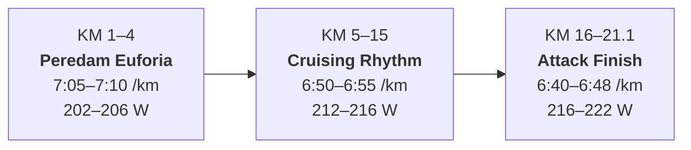
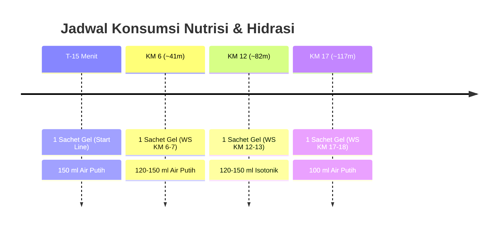

# 🏃 Virgin Half Marathon Race Plan — Target 2:25:00

**Athlete**: FadhilAlif (`i655618`)  
**Target Race**: Virgin Half Marathon (21.0975 km)  
**Race Date**: Minggu, 4 Oktober 2026  
**Target Finish Time**: **2 Jam 25 Menit 00 Detik** (Pace Rata-Rata: **6:52 /km**)  
**Baseline Biometrik**: Critical Power (CP) = **229 W** | LTHR = **179 bpm** | Berat = **63 kg** | Max HR = **204 bpm**  
**Device**: Garmin Forerunner 165  

---

## 📑 Daftar Isi
1. [Ringkasan Eksekutif & Target Waktu](#1-ringkasan-eksekutif--target-waktu)
2. [Strategi Pacing KM-by-KM (Negative Split)](#2-strategi-pacing-km-by-km-negative-split)
3. [Protokol Nutrisi Energi Gel (EJ Sport)](#3-protokol-nutrisi-energi-gel-ej-sport)
4. [Protokol Hidrasi & Termoregulasi Tropis](#4-protokol-hidrasi--termoregulasi-tropis)
5. [Konfigurasi Layar Data Garmin](#5-konfigurasi-layar-data-garmin)
6. [Timeline Operasional H-48 Jam Menuju Gun Time](#6-timeline-operasional-h-48-jam-menuju-gun-time)
7. [Protokol Pasca-Finish & Pemulihan](#7-protokol-pasca-finish--pemulihan)

---

## 1. Ringkasan Eksekutif & Target Waktu

Rencana balap ini dirancang dengan pendekatan **Negative Split Strategy** berbasis data telemetri historis latihan dari Intervals.icu. Pendekatan ini membagi perlombaan menjadi 3 segmen terukur untuk mengeliminasi risiko penumpukan asam laktat dini dan deplesi glikogen (*bonking*) pada kilometer 16 ke atas.



| Metrik Kunci | Nilai Rencana | Toleransi Aman |
|---|:---:|:---:|
| **Target Finish** | **2:25:00** | 2:25:00 – 2:28:00 |
| **Pace Rata-Rata** | **6:52 /km** | 6:52 – 7:01 /km |
| **Daya Rata-Rata (Watts)** | **212 – 215 W** | 92% – 94% Critical Power |
| **Batas Atas HR (s.d. KM 15)** | **≤ 166 bpm** | Jauh di bawah LTHR 179 bpm |

---

## 2. Strategi Pacing KM-by-KM (Negative Split)

### 📊 Tabel Rincian Segmen Balap

| Segmen | Jarak | Target Pace | Target Power | Target HR | Waktu Segmen | Waktu Kumulatif |
|---|:---:|:---:|:---:|:---:|:---:|:---:|
| **KM 1 – 4** | 4.0 km | **7:05 – 7:10 /km** | 202 – 206 W *(88–90% CP)* | < 155 bpm | 28m 30s | **00:28:30** |
| **KM 5 – 10** | 6.0 km | **6:52 – 6:55 /km** | 212 – 214 W *(92–93% CP)* | 158 – 162 bpm | 41m 18s | **01:09:48** |
| **KM 11 – 15** | 5.0 km | **6:50 – 6:52 /km** | 213 – 216 W *(93–94% CP)* | 162 – 166 bpm | 34m 12s | **01:44:00** |
| **KM 16 – 19** | 4.0 km | **6:44 – 6:48 /km** | 216 – 219 W *(94–95% CP)* | 168 – 174 bpm | 26m 56s | **02:10:56** |
| **KM 20 – 21.1** | 2.1 km | **6:38 – 6:42 /km** | 219 – 223 W *(95–97% CP)* | 174 – 178 bpm | 14m 04s | **02:25:00** |

### 🎯 Instruksi Taktis Per Segmen

#### A. Segmen 1: KM 1 – 4 (Adrenaline Guard / Peredam Euforia)
- **Tujuan**: Mencegah lonjakan asam laktat prematur akibat adrenalin kerumunan di garis start.
- **Tindakan**:
  - Pasang "rem tangan". Biarkan pelari lain menyalip Anda.
  - Napas ritmis santai 3 langkah tarik, 3 langkah buang (3-3 breathing).
  - Jangan panik jika waktu tertinggal ~1.5 menit dari target rata-rata di kilometer 4. Ini adalah tabungan energi Anda!

#### B. Segmen 2: KM 5 – 15 (The Engine Cruise / Irama Jelajah)
- **Tujuan**: Membangun ritme efisien (*steady state*) di zona Sub-Threshold.
- **Tindakan**:
  - Kunci kadens langkah di 174–176 spm (langkah pendek dan ringan).
  - Awasi power di Garmin: pertahankan rentang **212 – 216 Watt**.
  - Ambil air di setiap pos air dan telan energi gel sesuai jadwal.

#### C. Segmen 3: KM 16 – 21.1 (The Final Attack / Tebus Waktu)
- **Tujuan**: Menutup defisit waktu awal dan menuntaskan 21.1 km dengan performa puncak.
- **Tindakan**:
  - Telan Gel ke-4 di KM 17.
  - Naikkan frekuensi ayunan lengan dan dorongan ujung kaki.
  - Salip pelari-pelari di depan Anda yang mulai melambat atau berjalan kaki.
  - 400 meter terakhir: Maksimalkan sisa energi menuju *finish line arch*.

---

## 3. Protokol Nutrisi Energi Gel (EJ Sport)

*Spesifikasi Gel: 30g Karbohidrat (12g Maltodextrin + 18g Dextrose), 100mg L-Carnitine, Vitamin B Complex per sachet.*  
*Total Asupan: 4 Sachet = 120 gram karbohidrat (rata-rata 49.7 g/jam).*



| Titik Waktu / KM | Sachet | Target Asupan | Pendamping Cairan | Alasan Fisiologis |
|:---:|:---:|:---:|---|---|
| **T-15 Menit** | Gel #1 | 30g Carbs | 150 ml air mineral | Memastikan glukosa darah prima saat bendera start diangkat tanpa memicu sekresi insulin reaktif. |
| **KM 6 (~41m)** | Gel #2 | 30g Carbs | 120–150 ml air mineral | Diserap melalui transporter SGLT1 sebelum simpanan glikogen hati menurun drastis. |
| **KM 12 (~82m)** | Gel #3 | 30g Carbs | 120–150 ml isotonik | Titik pertengahan krusial. Mencegah penurunan daya kerja otot tungkai paruh kedua. |
| **KM 17 (~117m)**| Gel #4 | 30g Carbs | 100 ml air mineral | *Booster* saraf pusat untuk memicu akselerasi pace di 4.1 km terakhir. |

> [!IMPORTANT]
> **Aturan Wajib Minum Gel**: Selalu dorong energi gel dengan **air mineral murni (air putih)** di Water Station. Jangan mendorong gel dengan isotonik kental karena konsentrasi gula yang terlalu pekat dapat memperlambat pengosongan lambung dan memicu kram perut (*GI distress*).

---

## 4. Protokol Hidrasi & Termoregulasi Tropis

- **Karakteristik Lingkungan**: Suhu pagi 25–28°C, Kelembapan Relatif 75–85% (*High Thermal Stress*).
- **Laju Keringat Estimasi (BB 63 kg)**: **~760 ml/jam**.
- **Volume Target Cairan Masuk**: **500 – 600 ml/jam** (sekitar 1.2 – 1.4 liter total selama 2.4 jam perlombaan).
- **Target Elektrolit (Sodium)**: **~400 mg/jam**.

### 💧 Taktik di Setiap Water Station (WS)
1. **Pola Minum**: Minum 2–3 teguk kecil (100–120 ml) di setiap meja pos air. Jangan menenggak satu gelas penuh sekaligus.
2. **Rotasi Minuman**:
   - WS Ganjil (KM 3, 9, 15): Air Mineral murni.
   - WS Genap (KM 6, 12, 18): Minuman Isotonik (elektrolit).
3. **Pendinginan Fisik (*External Cooling*) [NSA §4.2]**:
   - Ambil spons basah atau siramkan sisa air cup ke tengkuk leher belakang, pergelangan tangan, dan kepala untuk meredam laju kenaikan suhu inti tubuh (*core body temperature*).

---

## 5. Konfigurasi Layar Data Garmin

Atur tata letak data pada **Garmin Forerunner 165** Anda sebagai berikut:

```
+-----------------------------------+
|             LAP PACE              |
|              6:52/km              |
+-----------------+-----------------+
|   POWER (W)     |   HEART RATE    |
|      214 W      |     161 bpm     |
+-----------------+-----------------+
|          ELAPSED TIME             |
|            01:15:30               |
+-----------------------------------+
```

- **Lap Pace (Besar di Atas)**: Panduan kecepatan kilometer berjalan saat fitur auto-lap berbunyi.
- **Power (Watts - Kiri)**: Metrik paling obyektif saat menemui rute menanjak, menurun, atau berlawanan arah angin.
- **Heart Rate (bpm - Kanan)**: Indikator alarm tubuh (pastikan tidak melampaui 166 bpm sebelum KM 15).
- **Elapsed Time (Bawah)**: Referensi waktu mutlak untuk memicu konsumsi energi gel tepat waktu.

---

## 6. Timeline Operasional H-48 Jam Menuju Gun Time

### Jumat, 2 Oktober 2026 (H-2)
- [x] Evaluasi status kebugaran (CTL 21.3, TSB menuju positif).
- [ ] **Malam Terpenting**: Tidur malam minimal 7.5 – 8 jam (tidur sebelum pukul 22.00). Kualitas tidur H-2 adalah fondasi utama hari lomba.

### Sabtu, 3 Oktober 2026 (H-1)
- [ ] **Aktivitas Fisik**: Istirahat total. Hindari berdiri atau berjalan terlalu lama di Race Village / Expo.
- [ ] **Nutrisi**: Konsumsi karbohidrat bersih (nasi putih, kentang rebus, pasta, ayam panggang). Hindari makanan pedas, bersantan, dan sayuran berserat sangat tinggi.
- [ ] **Hidrasi**: Minum air mineral 2–2.5 liter bertahap sepanjang hari diselingi 1 botol oralit / elektrolit.
- [ ] **Pengecekan Perlengkapan (Malam Hari)**:
  - Pasang nomor BIB pada jersey lari.
  - Siapkan sepatu balap dan kaos kaki anti-lecet.
  - Masukkan 4 sachet gel EJ Sport ke dalam kantong celana lari.
  - Isi baterai Garmin Forerunner 165 hingga 100%.
  - Potong kuku kaki pendek dan rapi.

### Minggu, 4 Oktober 2026 (Hari Perlombaan)
- **T-3 Jam 00 Menit (02:00 - 02:30)**:
  - Bangun tidur, minum 300 ml air hangat.
- **T-2 Jam 30 Menit**:
  - Sarapan ringan: 2 lembar roti tawar dengan selai strawberry/madu + 1 buah pisang.
- **T-1 Jam 30 Menit**:
  - Berangkat menuju lokasi start.
- **T-45 Menit**:
  - Masuk toilet untuk pengosongan kandung kemih terakhir.
  - Pemanasan dinamis ringan 10 menit (leg swing, butt kicks, high knees ringan). Hindari peregangan statis.
- **T-15 Menit**:
  - Masuk pen start.
  - Konsumsi **Gel #1 + 150 ml air**.
  - Aktifkan GPS pada Garmin Forerunner 165 hingga terkunci penuh.
- **T-00 Menit (GUN TIME)**:
  - Mulai berlari dengan tenang, tahan ego di 4 km pertama!

---

## 7. Protokol Pasca-Finish & Pemulihan

1. **Menit 0 – 15**: Tetap berjalan santai melewati *recovery area*, jangan langsung duduk mendadak agar peredaran darah vena tungkai tidak terhambat.
2. **Menit 15 – 30**: Minum 500–750 ml isotonik dan air mineral secara perlahan.
3. **Menit 30 – 60**: Konsumsi makanan padat berkarbohidrat dan protein (misal pisang, susu cokelat, roti isi telur).
4. **Hari H Sore**: Lakukan peregangan mobilitas ringan, kompres dingin/air es pada persendian jika terasa nyeri, dan istirahat total.

---

> 🏅 **Catatan Coach**:  
> *"Perlombaan 21.1 kilometer perdana Anda adalah hari perayaan atas konsistensi latihan yang telah Anda jalani sejak Agustus. Jalankan 15 kilometer pertama dengan disiplin matematika, dan selesaikan 6 kilometer terakhir dengan tekad penuh. Garis finish dan rekor 2:25:00 menanti Anda!"*
